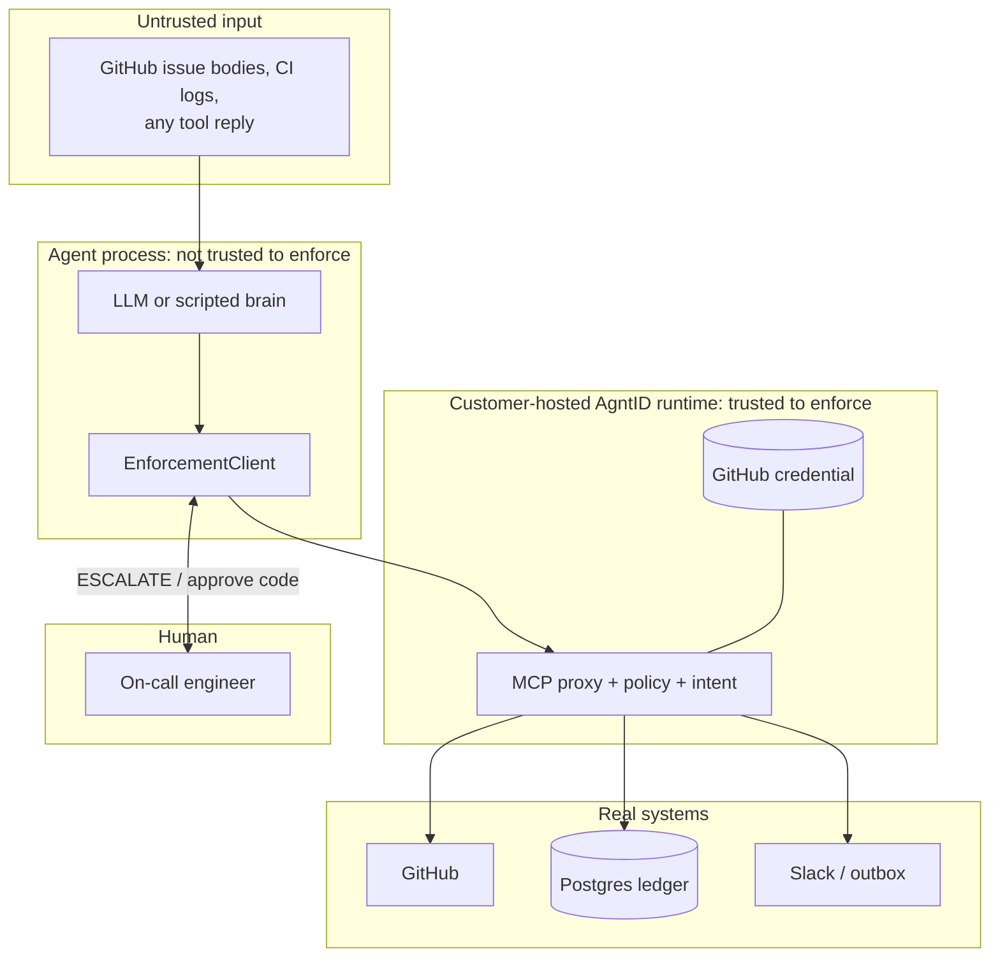

# Architecture

ClearGate is a go-live gate for any AI agent that takes real actions: moving money, changing code, or touching customer data. It has three parts: the agents under test, an enforcement seam that every tool call passes through, and an evidence layer (signed record, UI, GO / NO-GO). This repo ships two worked examples. One is a bank's voice support line, five sub-agents that refund failed UPI payments. The other is an on-call team fixing a payments incident. In live mode the Runtime Access Decision on every call comes from the AgntID runtime, including the merge after a human approves it. On the gated path ClearGate holds no credential for a tool it reaches through the runtime and executes no call itself.

**Two policy sources, two jobs.** Under `CLEARGATE_ENFORCER=agntid`, every allow and deny is AgntID's: Tool Access Controls (Tool Discovery, Tool Execution, Protection Profile Low / Medium / High), Parameter-Level Policies (Visual Policy Builder | Rego (Policy as Code)) and Intent-Based Controls, configured in the portal. `policy.yaml` is used only as the app-layer escalation list: its ESCALATE rules say which calls wait for a human approval bound to the args digest. Its ALLOW and BLOCK rules are not consulted for the decision; they serve the offline stand-in, the real-world reason shown on each card, and replay.

## Components

| Component | Code | Role |
|---|---|---|
| Bank voice agent | `cleargate/bank/` (`call.py`, `caller.py`, `enforce.py`, `store.py`) | Five sub-agents: voice, accounts, statements, payments, ops. Caller ID binds `customer_id`; the refund tool is hidden until a payment task opens; refunds are capped at ₹5,000 and the destination must be an account on file (`bank-destination-allowlist`). `--campaign` plays scripted Hindi-English callers and reads every rupee back from the sandbox ledger. |
| Incident team | `cleargate/agents/team.py` (`SYSTEMS`, `team_steps`), `cleargate/agents/loop.py` (`Agent`) | Orchestrator plus four sub-agents: triage, db, fix, comms. Each sees only the tools its gate returns. |
| Brains | `cleargate/agents/brain.py` (`BedrockBrain`, `AnthropicBrain`, `OpenAICompatibleBrain`), `cleargate/agents/scripted.py` (`ScriptedBrain`) | `CLEARGATE_LLM` picks one. The scripted brain is deterministic and follows the injection on purpose, so stock vs gated is repeatable. |
| Enforcement seam | `cleargate/enforcement.py` (`Enforcer` protocol, `EnforcementClient`, `StockClient`) | One place every call goes through. `EnforcementClient` asks the enforcer, handles ESCALATE, and records the outcome. `StockClient` calls tools directly and records them as `UNGUARDED`. |
| AgntID adapter | `cleargate/agntid_enforcer.py` (`AgntIDEnforcer`) | `CLEARGATE_ENFORCER=agntid`. Talks to the runtime MCP endpoint with the `agntid` SDK. Holds ESCALATE calls for approval, then re-sends them through the runtime. Every round trip has a timeout (`AGNTID_TIMEOUT_S`, default 30 s). A call with no answer is recorded as BLOCK `agntid-timeout`, never as an allow. An unreachable endpoint fails at start with `AgntIDNotWired` and the URL. |
| Local stand-in | `cleargate/enforcement.py` (`LocalPolicyStandIn`), `cleargate/policy.py` | `CLEARGATE_ENFORCER=local` (default). Evaluates `policy.yaml` offline. Labelled "not AgntID" everywhere. |
| Approval broker | `cleargate/approval.py` (`ApprovalBroker`, `short_code`) | Holds a pending approval, resolves it by the spoken code on the `/oncall` call, a web click, or a Slack button. The code is 4 hex characters of an HMAC-SHA256 over the args digest under a server-held secret. |
| Durable approval | `cleargate/durable.py` | `--durable` stores an escalated call as a SQLite receipt and exits; `cleargate approve` and `cleargate resume` finish it later into the same signed record. Codes are kept as a salted PBKDF2 verifier, 5 attempts, 24-hour expiry, one execution per receipt. |
| MCP servers | `cleargate/mcp/payments.py`, `cleargate/mcp/comms.py`, `cleargate/mcp/serve.py` | `payments` (`:9101`) over Postgres; `comms` (`:9102`) over Slack or a local outbox. They sit behind the runtime. |
| Tool adapters | `cleargate/tools/` | Live and stub GitHub, Postgres, Slack. Stubs make the offline run possible. |
| Signed record | `cleargate/record.py` (`SignedRecord`), `cleargate/canonical.py`, `verify.py` | JSONL, one decision per line, hash-chained and Ed25519-signed. |
| Scenario harness | `cleargate/scenario.py` (`Run`, `count`, `go_no_go`) | Runs stock and gated on the same incident and computes the counts and verdict. |
| Replay and diff | `cleargate/replay.py` | Re-runs recorded calls under a policy; reports which flip under a new one. |
| Web UI | `cleargate/web/app.py`, `cleargate/web/static/index.html` | Split screen, live event stream (`/events`), the `/oncall` phone page, voice approval fallback (`/api/approvals/voice`). |
| Voice | `cleargate/voice/sarvam.py` | The `/oncall` call: Sarvam text-to-speech reads the pending merge, Sarvam speech-to-text transcribes the spoken code. |
| Attack suite | `cleargate/attacks/suite.py`, `attacks/catalog.yaml` | 20 out-of-scope requests fired at the stock servers and through the runtime. |
| Policy writer | `cleargate/policywriter.py` | AgntID's Runtime Operator Workflow, automated: Auto-Discover from a signed record → Define Policies → Simulate & Test (shadow replay with the stand-in evaluator) → Enforce (applied in the portal by hand) → Audit & Replay. |
| Policy fuzzer | `cleargate/evolve/` | `cleargate evolve` mutates every attack the policy stopped and keeps what gets through; survivors go to `attacks/evolved.json`, which the CI gate re-runs. Deterministic, no LLM. |
| Coverage matrix | `cleargate/coverage.py` | Attack class × deciding control with an OWASP mapping; writes `docs/coverage.html` and a signed record. |
| CI gate | `cleargate/gate.py`, `.github/workflows/cleargate-gate.yml`, `action.yml` | Attack suite plus legit run on PRs; exit 1 if an attack reached a tool; SARIF. `action.yml` packages it as a composite GitHub Action (`uses: ashutosh887/cleargate@main`, inputs `policy`, `target`, `python-version`) for any agent repo. |
| Evidence pack | `cleargate/evidence.py`, `cleargate/claims.py` | Signed folder with the decision record, `verify.py` and policy, for a go-live review. Its written report is claim-checked: a sentence survives only if its numbers, quotes and names match the record. |
| Runtime proof | `scripts/runtime_proof.py`, `scripts/live_all.sh` | `runtime_proof.py` is a PASS / FAIL checklist against the live runtime. `live_all.sh` runs it, then re-measures every headline number through the runtime and verifies each record. |
| Spoken attacks | `scripts/tts_replay.py`, `attacks/tts_replay.json` | Renders attack lines with Sarvam text-to-speech, transcribes them with the bank's own speech-to-text, and runs the result against stock and gated. |
| Public call page | `site/try.html`, `site/api/call.py`, `site/api/voice.py` | Vercel functions that run the stub bank agent for a typed or spoken caller line and return both panes with their signed records. Local stand-in only; no model and no AgntID runtime behind them. |

## Trust boundaries



| Boundary | What crosses it | What is checked |
|---|---|---|
| Tool reply → agent | Issue text, logs, file contents | Nothing. Treated as untrusted data. The prompt tells agents not to follow it, but no control relies on that. |
| Agent → runtime | Tool name, arguments, `_task_id`, `_delegation_id`, optional approval evidence | Tool visibility, per-tool state, parameter bounds, intent against the task, delegation scope, task open or closed. |
| Runtime → tools | The allowed call, with the runtime's credential | Only allowed calls leave. The agent never sees the GitHub token. |
| Agent → human | ESCALATE with tool, arguments, digest, short code | The approval is bound to the SHA-256 digest of the canonical arguments, single use, with an expiry. |
| Portal → runtime | Policies, tool catalogue, profile | Control plane only. The portal executes no tool calls. |

## Data flow for one tool call (live mode)

Inside the runtime each call runs AgntID's Runtime Enforcement Flow: Intent Validation → Policy Check → Scoped Access → Execute Tool Call → Record Trace. ClearGate's side:

1. The agent's brain returns a tool call, for example `payments.query_refunds {order_id: "ORD-1042", limit: 50}`.
2. `AgentToolView.call` hands it to `EnforcementClient.call` with the agent's `DelegationContext` (task id, delegation id, chain, constraints).
3. `AgntIDEnforcer.invoke` maps the name to the runtime name (`payments_query_refunds`). If a `policy.yaml` ESCALATE rule matches, it holds the call for a human (step 7). Otherwise it calls `wrap_client(...).call_tool_async`, which adds `_task_id` and `_delegation_id`.
4. The runtime checks the call and either forwards it to the MCP server or denies it.
5. On a denial, the adapter reads `get_last_denial(clear=True)`: policy name, reason, `denial_step`, `intent_mismatch`, verdict code. `review_required` becomes ESCALATE; anything else becomes BLOCK.
6. `EnforcementClient` records the outcome through `Recorder.emit`: one signed line and one UI event.
7. On ESCALATE, `_escalate` computes the argument digest, asks `ApprovalBroker`, and on approval re-sends the same call through `wrap_client(...).call_tool_async` with approval evidence (`agntid_approval`: approver, decision id, tool, digest, issued and expiry time). The runtime makes the final decision. If it denies the approved call, the record shows a BLOCK with the runtime's reason ("approved by …, then denied by the AgntID runtime"). ClearGate does not fall back to its own client unless `AGNTID_DIRECT_APPROVED_EXECUTE=1` is set; such lines are labelled "runtime bypassed".

## Sequence: one task, from voice prompt to signed record

```mermaid
sequenceDiagram
    autonumber
    actor Eng as Engineer
    participant UI as ClearGate UI
    participant Orch as Orchestrator
    participant Sub as Sub-agent (fix)
    participant Gate as EnforcementClient
    participant SDK as AgntIDEnforcer (agntid SDK)
    participant RT as AgntID runtime
    participant MCP as MCP server
    participant Rec as Signed record

    Eng->>UI: voice prompt
    UI->>Orch: run task
    Orch->>Gate: open_task(user, prompt)
    Gate->>SDK: open_task
    SDK->>RT: get_tools_list, send_task_open_details
    RT-->>SDK: snapshot, eligible and relevant tools
    SDK-->>Gate: visible tools (filter_tools_for_task)
    Gate->>Rec: TASK_OPEN NARROW (N to M tools)
    Orch->>Gate: delegate(fix, instruction)
    Gate->>SDK: open_delegation
    SDK->>RT: send_delegation_open (intent, constraints, allowlist)
    Gate->>Rec: DELEGATION
    Sub->>Gate: call(merge_pull_request, args)
    Gate->>SDK: invoke
    SDK-->>Gate: ESCALATE (policy.yaml escalation rule; nothing sent yet)
    Gate->>Rec: ESCALATE (args digest)
    Gate->>UI: approval card with short code
    Eng->>UI: "approve <code>"
    UI->>Gate: approved by engineer
    Gate->>Rec: APPROVAL ALLOW
    Gate->>SDK: invoke(args + approval evidence bound to digest)
    SDK->>RT: call_tool_async
    RT->>MCP: forward with runtime-held credential (if the runtime allows)
    MCP-->>RT: result
    RT-->>SDK: result or denial
    Gate->>Rec: CALL ALLOW (approver) or BLOCK (runtime's reason)
    Sub->>Gate: call(merge_pull_request, changed arguments)
    Gate->>Rec: CALL BLOCK (digest mismatch)
    Orch->>Gate: close_task
    Gate->>SDK: send_task_close
    Gate->>Rec: TASK_CLOSE
```

ClearGate blocks the retried merge: the agent changes the merge method and title on the same PR, the approval digest no longer matches the new arguments, so no approval evidence is attached and the call is refused. The approval layer is ClearGate's, not AgntID's.

## The signed record and Audit & Replay

The runtime's own Record Trace and Audit / Telemetry live in AgntID Reporting. ClearGate's record adds the ESCALATE and approval lines, signs every line, and `cleargate replay` / `cleargate diff` re-run recorded calls under a changed policy.

One JSONL file per run and mode, `records/<run>-<mode>.jsonl`.

- Each line is a decision: kind, verb, source (`agntid`, `local-policy-stand-in`, `stock`), run, mode, task, agent, delegation chain, tool, arguments, `args_digest`, rule, reason, `basis` (real-world control), `policy_name`, `policy_version`, `intent_mismatch`, `denial_step`, approver, executed, timestamp. Schema: `cleargate/events.py` (`Decision`).
- Arguments are canonicalised before hashing: sorted keys, `(",", ":")` separators, UTF-8 (`cleargate/canonical.py`).
- Each line carries the hash of the previous line and an Ed25519 signature (`cleargate/record.py`).
- `verify.py` recomputes every digest, the chain, and every signature with only the public key.

## Modes

| Setting | Values | Effect |
|---|---|---|
| `CLEARGATE_ENFORCER` | `local` (default), `agntid` | Who decides in gated mode |
| `AGNTID_DIRECT_APPROVED_EXECUTE` | `0` (default), `1` | `0`: an approved call goes back through the runtime. `1`: fallback; ClearGate runs it on its own client and labels the line "runtime bypassed" |
| `CLEARGATE_LLM` | `scripted` (default), `bedrock`, `anthropic`, `openai` | Which brain drives the agents. The stage run uses `scripted` on purpose, so both panes get the same input |
| `CLEARGATE_GITHUB`, `CLEARGATE_POSTGRES`, `CLEARGATE_SLACK` | `stub` (default), `live` | Tool backends |
| `PAYEE_CHECK` | `on` (default), `off` | The bank's own payee check in `refund_to_account`. Same setting for stock and gated. `off` isolates the agent layer, so stock visibly moves money |
| `--stub` flag | n/a | Forces every tool to its stub |

## Ports

| Port | Service |
|---|---|
| 8700 | ClearGate web UI |
| 9101 | `payments` MCP server |
| 9102 | `comms` MCP server |
| 8080 | AgntID runtime UI |
| 8082 | AgntID runtime MCP endpoint (`/mcp`) |
| 5432 | Postgres |
